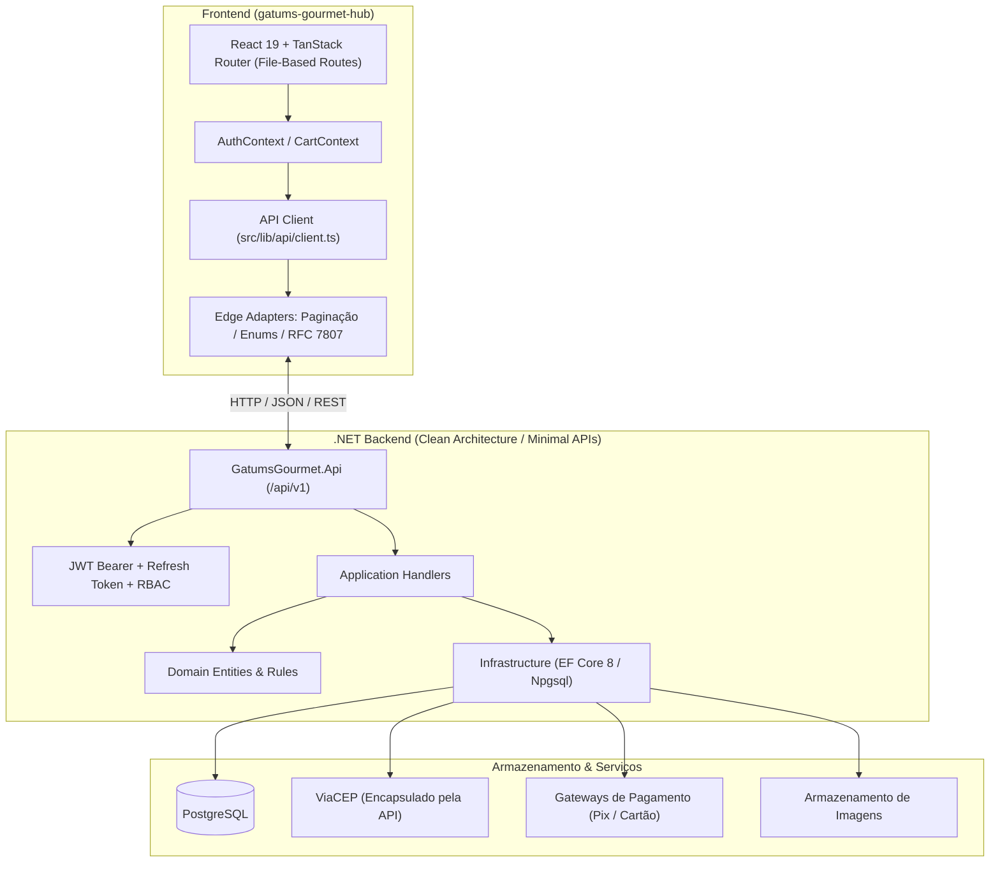
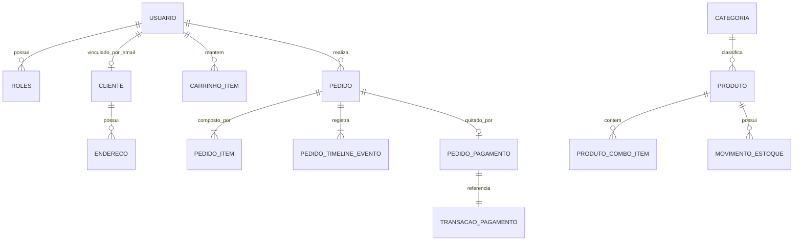
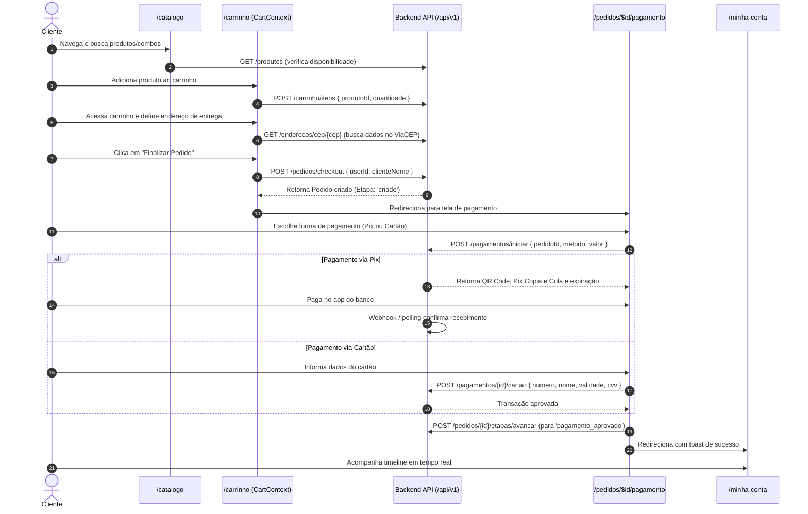
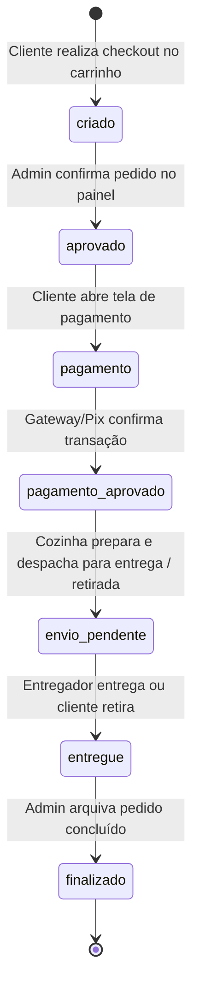
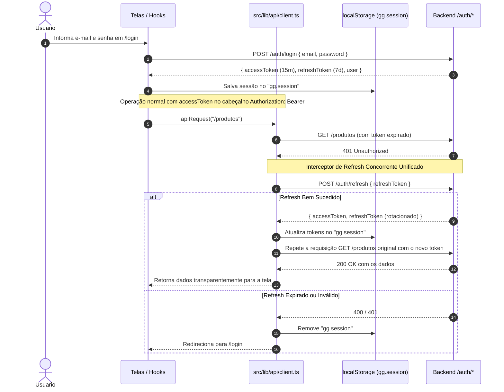
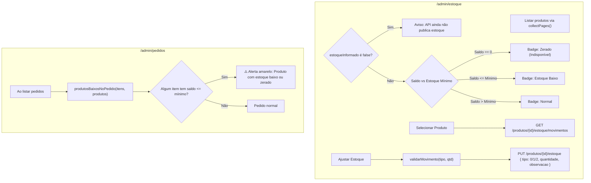

# Contexto Geral do Projeto — Gatums Gourmet Hub

> **Documento mestre de contexto e fluxo operacional do projeto.**
> Criado para humanos e agentes de inteligência artificial (IAs) compreenderem a arquitetura completa, o domínio do negócio, os fluxos ponta a ponta, os contratos de dados e as convenções invioláveis para garantir continuidade sem regressões.

---

## 1. Identidade e Visão Geral

O **Gatums Gourmet Hub** é uma plataforma completa de e-commerce e gestão para uma hamburgueria e cozinha artesanal gourmet (*Gatums Gourmet*).

O ecossistema é dividido em duas grandes experiências:
1. **Loja do Cliente (B2C / Webshop):**
   - Navegação na vitrine de produtos e combos artesanais.
   - Catálogo com busca textual, filtro de categorias e status de disponibilidade baseado em estoque real.
   - Carrinho persistido na API com cálculo de frete e múltiplos endereços.
   - Checkout com pedidos em 7 etapas e pagamentos via Pix (QR Code dinâmico + Copia e Cola) ou Cartão de Crédito/Débito.
   - Área "Minha Conta" com consulta de pedidos e timeline de progresso em tempo real.
2. **Painel Administrativo (Backoffice / Gestão):**
   - Visão Geral (Dashboard) com indicadores de faturamento, pedidos e clientes.
   - Gestão de Produtos (simples e combos) e upload de imagens.
   - Gestão de Categorias com paginação e busca.
   - Controle de Estoque (saldos, estoque mínimo, alertas e histórico de movimentações: entrada, saída e ajuste).
   - Gestão de Pedidos com máquina de estados (avanço de etapas na timeline) e alertas de estoque baixo dos produtos do pedido.
   - CRM de Clientes integrado com a gestão de Contas/Usuários e atribuição de perfis RBAC (.NET Identity).
   - Relatórios analíticos de vendas com gráficos de série temporal e rankings.

---

## 2. Arquitetura do Sistema e Stack Tecnológica

O projeto adota uma arquitetura desacoplada: **Frontend SSR/SPA moderno** consumindo uma **API RESTful .NET com Clean Architecture**.



### Stack do Frontend
- **Framework & Runtime:** TanStack Start (`@tanstack/react-start`) com React 19 e Vite 7.
- **Roteamento:** `@tanstack/react-router` com File-Based Routing em `src/routes/`.
- **Estilização:** Tailwind CSS v4 (`@tailwindcss/vite`), variantes com `class-variance-authority` e `clsx` / `tailwind-merge`.
- **Componentes Base:** Radix UI primitives (`dialog`, `select`, `dropdown-menu`, `tabs`, `sheet`, `popover`, etc.).
- **Formulários & Validação:** React Hook Form + Zod.
- **Ícones & Notificações:** Lucide React e Sonner (`toast`).
- **Visualização de Dados:** Recharts (série diária de faturamento).
- **QR Code:** `qrcode` para geração do Pix Copia e Cola / QR Code no browser.

### Stack do Backend (Referência de Integração)
- **Plataforma:** .NET 8 / .NET 10 Minimal APIs com C# e Clean Architecture.
- **Banco de Dados:** PostgreSQL com Entity Framework Core.
- **Segurança:** JWT Bearer com Access Token (15 minutos) + Refresh Token (7 dias), com controle de autorização RBAC por perfil (`roles`) e permissões (`permissions`).
- **Contratos:** Versionamento sob `/api/v1`, paginação com envelope em português (`itens`, `totalRegistros`), padronização de erros RFC 7807 `ProblemDetails`.

---

## 3. Ambientes, Configurações e Deploy

### Variáveis de Ambiente

| Variável | Descrição | Exemplo Local | Exemplo Produção |
|---|---|---|---|
| `VITE_API_BASE_URL` | Raiz da API **SEM** a versão. O client anexa `/api/${VITE_API_VERSION}` | `http://localhost:5166` | `https://gatumsgourmet.com.br` |
| `VITE_API_VERSION` | Versão da API (padrão: `v1`) | `v1` | `v1` |
| `VITE_PAYMENTS_MOCK` | Simula pagamentos localmente via `localStorage` se `true` | `true` | `false` |
| `DEPLOY_TARGET` | Define o alvo de build (`node-server`, `vercel-spa`) | — | `vercel-spa` (HML) |

> [!IMPORTANT]
> **Atenção ao protocolo local:** A API Kestrel em desenvolvimento roda em **HTTP** puro (`http://localhost:5166`). Não utilize `https://` em ambiente local. A base efetiva gerada por `buildApiBaseUrl()` resulta em `http://localhost:5166/api/v1`.

### Estrutura de Deploys

1. **Produção (SSR na VPS Locaweb):**
   - Aplicação rodando como Node SSR em container Docker (`Dockerfile` multi-stage, Node 22 + npm 11).
   - Servidor Node (`server/node-server.mjs`) escutando na porta 3000 interna.
   - Nginx host fazendo proxy reverso de `app.gatumsgourmet.com.br` para a porta publicada (8090) com TLS Let's Encrypt.
   - GitHub Actions constrói a imagem no runner e transfere via SSH (`docker load`), pois a VPS de 512MB estoura o heap se compilar localmente.
2. **Homologação (Vercel SPA):**
   - Pipeline no GitHub Actions dispara após aprovação em PRs para a branch `release`.
   - Build estático com `DEPLOY_TARGET=vercel-spa`, gerando fallback SPA em `dist/client/_shell.html`.
   - Aponta para a API de homologação no Render (`https://gatums-gourmet-api.onrender.com/api/v1`).
3. **Desenvolvimento Local:**
   - `npm run dev` para subir o Vite em modo desenvolvimento.

---

## 4. Regras Arquiteturais Invioláveis (AGENTS.md)

Toda alteração de código realizada por IAs ou desenvolvedores **DEVE SEGUIR RIGOROSAMENTE** as seguintes regras:

1. **Manter File Routes do TanStack e Serviços de API Isolados:**
   - Novas rotas devem ser criadas em `src/routes/` seguindo as convenções do `@tanstack/react-router`.
   - Toda e qualquer chamada HTTP externa deve ficar em `src/lib/api/<modulo>.ts`. Não utilize `fetch` diretamente nas telas.
2. **Autoridade de Acesso é Sempre da API (RBAC via Endpoints de Usuário):**
   - Papéis de clientes e usuários são atribuídos exclusivamente através dos endpoints `/roles` e `/usuarios/{id}/roles`.
   - **Nunca** crie ou confie em estado de permissão local mockado para elevar privilégios. A autoridade máxima de segurança é o backend.
3. **Uso Obrigatório de `collectPages` e `SearchPagination`:**
   - Em telas que realizam filtragem, ordenação ou agrupamento local completo (como catálogo, pedidos e estoque), use `collectPages` para varrer todas as páginas da API antes do processamento.
   - Nunca fixe limites artificiais como `pageSize: 100` esperando que seja o total do banco.
   - Utilize o componente `SearchPagination` para novos controles de paginação no frontend.
4. **Resumo de Vendas e Metadados de Rota:**
   - Toda a lógica e renderização do resumo de faturamento e vendas deve permanecer isolada no componente `SalesSummary`.
   - Metadados de páginas filhas (título e descrição da tag head) devem usar obrigatoriamente a função auxiliar `pageHead()`.
5. **Normalização e Disponibilidade de Estoque:**
   - Caso a API retorne um produto sem os campos `estoque` e `estoqueMinimo`, considere `estoqueInformado = false` (estado **desconhecido**, e **nunca** estoque zerado).
   - Quando o saldo for explicitamente `0`, o frontend marca `disponivel = false`, desabilitando o botão de compra.
   - Consultas de leitura (GET) **nunca** devem disparar mutações (PUT/POST) na API em segundo plano.
6. **Alertas de Estoque em Pedidos:**
   - Alertas visuais de estoque baixo no pedido usam o saldo de estoque atual do produto no momento da consulta (`estoque <= estoqueMinimo`).
   - **Nunca** subtraia novamente as quantidades contidas no pedido, pois o checkout na API já debita o estoque do produto.

---

## 5. Modelos de Domínio e Entidades Principais



### Principais Entidades e Tipos TypeScript (`src/lib/api/`)

- **`Produto`:**
  - `id`: string (UUID)
  - `nome`: string
  - `descricao`: string
  - `categoriaId`: number
  - `categoriaNome`: string
  - `preco`: number (R$)
  - `foto`: string (URL)
  - `disponivel`: boolean (computado via `p.disponivel && (p.estoqueInformado === false || p.estoque > 0)`)
  - `tipo`: `"simples"` | `"combo"`
  - `itens?`: `ItemCombo[]` (apenas para combo: `produtoId` e `quantidade`)
  - `estoque`: number (saldo atual)
  - `estoqueMinimo`: number
  - `estoqueInformado?`: boolean (flag de borda: true se veio da API, false se omitido)
- **`Categoria`:**
  - `id`: number
  - `nome`: string
  - `descricao`: string | null
  - `ativo`: boolean
- **`Pedido`:**
  - `id`: string (UUID)
  - `userId`: string
  - `clienteNome`: string
  - `itens`: `CartItem[]`
  - `total`: number
  - `data`: string (ISO-8601)
  - `timeline`: `PedidoEvento[]` (histórico ordenado das 7 etapas)
  - `pagamento?`: `{ transacaoId, resumo, aprovadoEm }`
- **`PedidoEtapa` (Máquina de Estados de 7 Passos):**
  - `"criado"` | `"aprovado"` | `"pagamento"` | `"pagamento_aprovado"` | `"envio_pendente"` | `"entregue"` | `"finalizado"`
- **`TransacaoPagamento`:**
  - `id`: string
  - `pedidoId`: string
  - `metodo`: `"pix"` | `"cartao_debito"` | `"cartao_credito"`
  - `valor`: number
  - `status`: `"criada"` | `"aguardando_pagamento"` | `"processando"` | `"aprovada"` | `"recusada"` | `"expirada"` | `"cancelada"`
  - `pixCopiaCola?`: string
  - `pixQrCodeDataUrl?`: string
  - `pixExpiraEm?`: string
- **`Cliente` (CRM):**
  - `id`: string (UUID)
  - `nome`: string
  - `email`: string
  - `telefone`: string
  - `cidade`: string
  - `endereco?`: `Endereco` (com CEP, logradouro, número, bairro, UF)
- **`Usuario` & `Role` (Identidade e Permissões):**
  - `Usuario`: `id`, `nome`, `email`, `roles: string[]`, `ativo`
  - `Role`: `id: number`, `nome: string` (ex: "Admin", "Cliente", "Gerente")
  - `Permission`: `id: number`, `codigo: string`, `recurso: string`, `acao: string`

---

## 6. Diagramas dos Fluxos Operacionais

### 6.1. Fluxo de Compra e Checkout do Cliente



---

### 6.2. Máquina de Estados do Pedido (Timeline de 7 Etapas)



**Metadados de cada etapa:**
| Etapa | Label no Frontend | Ator Responsável | Ação Seguinte |
|---|---|---|---|
| `criado` | Pedido criado | `cliente` | Aprovar pedido (Admin) |
| `aprovado` | Pedido aprovado | `admin` | Realizar pagamento (Cliente) |
| `pagamento` | Pagamento | `cliente` | Confirmar pagamento (Gateway/Admin) |
| `pagamento_aprovado` | Pagamento aprovado | `admin` (gateway) | Despachar entrega ou retirada (Admin) |
| `envio_pendente` | Em trânsito / Aguardando | `admin` | Marcar como entregue (Admin) |
| `entregue` | Entregue | `admin` | Finalizar pedido (Admin) |
| `finalizado` | Pedido finalizado | `admin` | — |

---

### 6.3. Fluxo de Autenticação, RBAC e Token Refresh Automático



---

### 6.4. Gestão de Clientes e Sincronização de Usuários (.NET Identity)

No painel `/admin/clientes`, os clientes do CRM são sincronizados com os logins de usuários do sistema de identidade:

```mermaid
flowchart TD
    Inicio([Salvar Cliente no Admin]) --> BuscarUsuarios[GET /usuarios e GET /roles]
    BuscarUsuarios --> MatchEmail{Existe usuário com este e-mail?}
    
    MatchEmail -- Sim --> UpdateRole[PUT /usuarios/{id}/roles com roleId selecionado]
    MatchEmail -- Não --> ValidarSenha{Senha inicial foi informada?}
    
    ValidarSenha -- Não --> ErroSenha[Exibe erro: 'Informe uma senha inicial para criar o usuário']
    ValidarSenha -- Sim --> CreateUser[POST /usuarios com nome, email, senha, telefone e roleIds]
    
    UpdateRole --> SaveCRM[POST /clientes ou PUT /clientes/{id}]
    CreateUser --> SaveCRM
    SaveCRM --> Fim([Cliente e Acessos Sincronizados com Sucesso])
```

---

### 6.5. Fluxo de Estoque, Alertas e Movimentações



---

## 7. Mapeamento de Rotas e Telas

```
src/routes/
├── __root.tsx                                # Root layout: HTML head, Providers, Sonner Toaster
├── index.tsx                                 # / -> Vitrine, Destaques Gourmet, Banners
├── sobre.tsx                                 # /sobre -> História e conceitos artesanais da marca
├── catalogo.tsx                              # /catalogo -> Busca de produtos, filtro categorias, combos
├── login.tsx                                 # /login -> Autenticação com e-mail e senha
├── register.tsx                              # /register -> Cadastro de novos clientes
├── _authenticated.tsx                        # Layout de guarda: exige usuário autenticado
│   ├── carrinho.tsx                          # /carrinho -> Gestão de itens, frete, endereço, checkout
│   ├── minha-conta.tsx                       # /minha-conta -> Dados, endereços (ViaCEP), timeline dos pedidos
│   ├── pedidos.$pedidoId.pagamento.tsx       # /pedidos/:id/pagamento -> Checkout Pix e Cartão
│   └── admin.tsx                             # Layout com sidebar administrativa (guarda role Admin)
│       └── admin/
│           ├── index.tsx                     # /admin -> Dashboard (faturamento, pedidos, clientes)
│           ├── produtos.tsx                  # /admin/produtos -> CRUD produtos e combos, upload imagem
│           ├── categorias.tsx                # /admin/categorias -> CRUD categorias com busca e paginação
│           ├── pedidos.tsx                   # /admin/pedidos -> Gestão de pedidos, avanço de etapas, alertas
│           ├── clientes.tsx                  # /admin/clientes -> CRM de clientes e sincronização de roles
│           ├── estoque.tsx                   # /admin/estoque -> Saldos, histórico e ajustes de estoque
│           └── relatorios.tsx                # /admin/relatorios -> Resumo de vendas, gráficos e rankings
```

---

## 8. Módulos da Camada de Integração (`src/lib/api/`)

Todos os serviços encapsulam a comunicação HTTP através do helper `apiRequest` em `client.ts`:

| Módulo | Arquivo | Principais Endpoints Consumidos |
|---|---|---|
| **Config & Paginação** | `config.ts` | Helpers de composição de URL (`API_BASE_URL`), `appendPageParams`, `mapPaginated` |
| **Cliente HTTP & Token** | `client.ts` | `apiRequest`, fila de refresh concorrente (`/auth/refresh`), interceptor de erros RFC 7807 |
| **Autenticação & Sessão** | `auth.ts` | `POST /auth/login`, `POST /auth/register`, `POST /auth/refresh`, `userIsAdmin()` |
| **Produtos & Combos** | `produtos.ts` | `GET/POST/PUT/DELETE /produtos`, `GET/PUT /produtos/{id}/estoque`, `/movimentos`, `/estoque/baixo` |
| **Categorias** | `categorias.ts` | `GET /categorias` (com `pagina`, `tamanho`, `apenasAtivas`), `POST`, `PUT`, `DELETE /categorias/{id}` |
| **Carrinho** | `carrinho.ts` | `GET /carrinho`, `POST /carrinho/itens`, `PATCH/DELETE /carrinho/itens/{id}`, `POST /pedidos/checkout` |
| **Pedidos** | `pedidos.ts` | `GET /pedidos`, `GET /pedidos/{id}`, `POST /pedidos/{id}/etapas/avancar`, `POST /pedidos/{id}/pagamento/concluir` |
| **Pagamentos** | `pagamentos.ts` | `GET /pagamentos/opcoes`, `POST /pagamentos/iniciar`, `POST /pagamentos/{id}/cartao`, normalização de enums |
| **Clientes CRM** | `clientes.ts` | `GET /clientes` (paginado), `POST /clientes`, `PUT /clientes/{id}`, `DELETE /clientes/{id}` |
| **Usuários & Contas** | `usuarios.ts` | `GET /usuarios`, `GET /usuarios/{id}`, `POST /usuarios`, `PUT /usuarios/{id}/roles` |
| **Roles & RBAC** | `roles.ts` | `GET /roles`, `POST /roles`, `PUT /roles/{id}` |
| **Permissões** | `permissions.ts` | `GET /permissions`, `POST /permissions` |
| **Endereços & CEP** | `enderecos.ts` | `GET /enderecos/cep/{cep}` (API encapsula o ViaCEP sem bater direto no serviço externo) |
| **Imagens** | `imagens.ts` | `POST /imagens/upload` (FormData multipart, com validação de tipo e tamanho de 5MB) |
| **Relatórios / Vendas** | `vendas.ts` | `GET /relatorios/vendas/resumo` (exibido e normalizado via `SalesSummary`) |

---

## 9. Adaptações de Borda e Padrões de Contrato

A API .NET possui convenções específicas que o frontend adapta de forma transparente na camada de borda:

1. **Paginação Bilíngue:**
   - **Formato da API (Português):**
     - Query Parameters: `?pagina=1&tamanho=10`
     - Resposta: `{ itens: [], totalRegistros: 100, paginaAtual: 1, tamanhoPagina: 10, totalPaginas: 10 }`
   - **Formato Interno do Frontend:**
     - `PaginatedResponse<T>` com `{ items: T[], total: number, page: number, pageSize: number }`
     - Adaptado centralizadamente por `appendPageParams` e `mapPaginated` em `src/lib/api/config.ts`.
2. **Normalização de Enums Flexíveis:**
   - Tipos de produto: 0 = "simples", 1 = "combo".
   - Tipos de movimento de estoque: 0 = "entrada", 1 = "saida", 2 = "ajuste", 3 = "venda".
   - Métodos de pagamento e status toleram inteiros, strings minúsculas com ou sem sublinhado (ex.: `cartaocredito` vs `cartao_credito`).
3. **Upload de Imagens:**
   - Utiliza `FormData` multipart. O client HTTP **NÃO** deve definir `Content-Type: application/json` quando o corpo for `FormData`, permitindo que o navegador defina o boundary multipart correto.
4. **Erros RFC 7807 (ProblemDetails):**
   - Respostas de erro da API seguem `{ title, status, detail }`.
   - `apiRequest` captura o `detail` e lança `ApiError(detail, status, code)`. As telas exibem o `detail` amigável diretamente nos toasts.

---

## 10. Checklist para IAs: Como Continuar o Desenvolvimento sem Erros

Antes de propor ou implementar código no projeto, verifique os seguintes pontos:

- [ ] **Não quebrou rotas TanStack?** Preservou a convenção `Route = createFileRoute(...)` e as funções de carregamento?
- [ ] **Usou a camada de serviços da API?** Não fez chamadas `fetch` soltas nos componentes?
- [ ] **Utilizou `collectPages` ao fazer filtros locais?** Se a tela faz busca ou ordenação em memória, garantiu a leitura de todas as páginas da API com `collectPages`?
- [ ] **Tratou o estoque desconhecido?** Verificou se `estoqueInformado === false` é tratado como desconhecido (não exibindo 0)?
- [ ] **Não recalculou estoque em pedidos?** Usou o saldo atual sem subtrair novamente os itens já comprados?
- [ ] **Manteve a autoridade de perfis na API?** A atribuição de permissões foi feita via `/usuarios/{id}/roles` e `/roles`?
- [ ] **Manteve títulos de página no `pageHead()`?** Não duplicou tags de `<title>` ou meta tags fora do padrão?
- [ ] **Validou contratos de formulário com Zod/RHF?** Inputs numéricos monetários usam o componente `PrecoInput`?
- [ ] **Preservou a URL base sem versão?** Manteve `VITE_API_BASE_URL` sem o `/api/v1` fixo, usando `buildApiBaseUrl()`?

