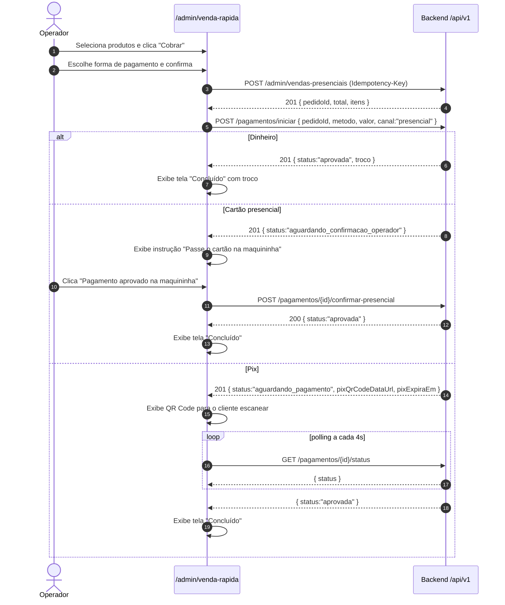

# Venda presencial — referência de integração de backend

Este documento descreve o contrato que o backend precisa implementar para que a tela `/admin/venda-rapida` processe vendas presenciais de ponta a ponta. Hoje o fluxo de seleção de produtos, cálculo de troco e confirmação local já funciona no frontend; a integração com a API está pendente dos endpoints abaixo.

---

## 1. Contexto do fluxo atual (frontend)

A tela opera em três passos dentro de um único layout (catálogo à esquerda, painel lateral à direita):

```
[Passo 1 — Carrinho]      Operador seleciona produtos, informa o nome do cliente (opcional)
        ↓  clica "Cobrar"
[Passo 2 — Pagamento]     Operador escolhe forma e informa valor recebido (se dinheiro)
        ↓  clica "Confirmar pagamento"
[Passo 3 — Concluído]     Exibe total cobrado, troco e botão "Nova venda"
```

O estado é local e efêmero. Ao confirmar o pagamento, o frontend já tem todos os dados necessários para criar um pedido e registrar o pagamento via API em uma única sequência de chamadas.

---

## 2. Endpoints necessários

### 2.1. Criar venda presencial

```
POST /api/v1/admin/vendas-presenciais
Authorization: Bearer <token_admin>
Idempotency-Key: <uuid_gerado_pelo_cliente>
Content-Type: application/json
```

**Corpo**

```json
{
  "clienteNome": "João Silva",
  "operadorId": "<userId do admin logado>",
  "itens": [
    { "produtoId": "3fa85f64-5717-4562-b3fc-2c963f66afa6", "quantidade": 2 },
    { "produtoId": "7cb96a21-1234-4000-a111-aabbccddeeff", "quantidade": 1 }
  ]
}
```

| Campo | Tipo | Obrigatório | Notas |
|---|---|---|---|
| `clienteNome` | string | Não | Se omitido, registrar como "Balcão" ou equivalente interno |
| `operadorId` | string (UUID) | Sim | ID do usuário admin extraído do JWT; nunca confiar no valor do body em vez do claim |
| `itens[].produtoId` | string (UUID) | Sim | Deve existir e estar disponível |
| `itens[].quantidade` | integer ≥ 1 | Sim | |

**Resposta 201 Created**

```json
{
  "pedidoId": "aabbccdd-0000-0000-0000-112233445566",
  "total": 89.70,
  "itens": [
    { "produtoId": "3fa85f64-...", "produtoNome": "Burger Clássico", "quantidade": 2, "precoUnitario": 32.90, "subtotal": 65.80 },
    { "produtoId": "7cb96a21-...", "produtoNome": "Refrigerante 350ml", "quantidade": 1, "precoUnitario": 7.90, "subtotal": 7.90 }
  ],
  "canal": "presencial",
  "operadorId": "...",
  "clienteNome": "João Silva",
  "criadoEm": "2025-01-15T14:32:00.000Z"
}
```

**Regras do servidor**

- Calcular e retornar o `total` no servidor a partir dos preços cadastrados. Nunca aceitar preço ou total enviados pelo cliente.
- Validar disponibilidade e saldo de estoque de todos os itens em uma única transação atômica antes de criar o pedido.
- Registrar um movimento de estoque do tipo `venda` para cada item no momento da criação.
- O pedido entra diretamente na etapa `pagamento` (pulando `criado` e `aprovado`, que são etapas do fluxo online).
- A `Idempotency-Key` garante que reenvios por falha de rede não criem pedidos duplicados; retornar o pedido original com `200` se a chave já foi processada.
- Retornar `400` se algum produto não existir, estiver indisponível ou com saldo insuficiente — incluindo no `detail` o nome do produto problemático.
- Retornar `403` se o token não tiver a permissão de venda presencial.

---

### 2.2. Registrar pagamento da venda presencial

Reutiliza o endpoint existente de pagamentos, mas com formas estendidas para o contexto presencial.

```
POST /api/v1/pagamentos/iniciar
Authorization: Bearer <token_admin>
Idempotency-Key: <uuid_gerado_pelo_cliente>
Content-Type: application/json
```

**Corpo**

```json
{
  "pedidoId": "aabbccdd-0000-0000-0000-112233445566",
  "metodo": "dinheiro",
  "valor": 89.70,
  "valorRecebido": 100.00,
  "canal": "presencial"
}
```

| Campo | Tipo | Obrigatório | Notas |
|---|---|---|---|
| `pedidoId` | string (UUID) | Sim | Deve pertencer ao operador ou ser uma venda presencial |
| `metodo` | string | Sim | Ver tabela de métodos abaixo |
| `valor` | number | Sim | O servidor valida contra o total do pedido; rejeitar se divergir |
| `valorRecebido` | number | Apenas para `dinheiro` | Deve ser ≥ `valor`; troco calculado pelo servidor |
| `canal` | string | Sim | `"presencial"` para venda no balcão |

**Métodos aceitos no canal presencial**

| `metodo` | Descrição | Integração |
|---|---|---|
| `dinheiro` | Pagamento em espécie | Nenhuma; confirmação imediata |
| `cartao_debito` | Débito via maquininha | Confirmação manual pelo operador (ver §2.3) |
| `cartao_credito` | Crédito via maquininha | Confirmação manual pelo operador (ver §2.3) |
| `pix` | Pix via QR Code dinâmico | PSP gera QR; confirmação via webhook (ver §2.4) |

**Resposta 201 Created — dinheiro**

```json
{
  "id": "tx_cash_xxx",
  "pedidoId": "aabbccdd-...",
  "metodo": "dinheiro",
  "valor": 89.70,
  "valorRecebido": 100.00,
  "troco": 10.30,
  "status": "aprovada",
  "canal": "presencial",
  "aprovadoEm": "2025-01-15T14:33:00.000Z"
}
```

**Resposta 201 Created — cartão presencial**

```json
{
  "id": "tx_card_xxx",
  "pedidoId": "aabbccdd-...",
  "metodo": "cartao_debito",
  "valor": 89.70,
  "status": "aguardando_confirmacao_operador",
  "canal": "presencial"
}
```

**Resposta 201 Created — Pix presencial**

```json
{
  "id": "tx_pix_xxx",
  "pedidoId": "aabbccdd-...",
  "metodo": "pix",
  "valor": 89.70,
  "status": "aguardando_pagamento",
  "canal": "presencial",
  "pixCopiaCola": "00020126...",
  "pixQrCodeDataUrl": "data:image/png;base64,...",
  "pixExpiraEm": "2025-01-15T15:03:00.000Z"
}
```

---

### 2.3. Confirmar pagamento de cartão presencial (operador)

Após a maquininha aprovar, o operador toca "Confirmar" no frontend.

```
POST /api/v1/pagamentos/{transacaoId}/confirmar-presencial
Authorization: Bearer <token_admin>
Content-Type: application/json
```

```json
{
  "aprovado": true,
  "observacao": "Aprovado na maquininha Stone #0042"
}
```

**Resposta 200**

```json
{
  "id": "tx_card_xxx",
  "status": "aprovada",
  "aprovadoEm": "2025-01-15T14:35:00.000Z"
}
```

Ao aprovar, o servidor avança o pedido para a etapa `pagamento_aprovado` automaticamente.

---

### 2.4. Status do Pix (polling)

Reutiliza o endpoint existente.

```
GET /api/v1/pagamentos/{transacaoId}/status
Authorization: Bearer <token_admin>
```

O frontend faz polling a cada 4 segundos até `status === "aprovada"` ou `pixExpiraEm` ser ultrapassado. Ao aprovar via webhook do PSP, o servidor avança o pedido para `pagamento_aprovado`.

---

## 3. Sequência completa de chamadas (frontend → backend)



---

## 4. Máquina de estados do pedido presencial

O pedido presencial entra na etapa `pagamento` diretamente na criação. As etapas `criado` e `aprovado` são exclusivas do fluxo online (cliente faz checkout, admin aprova).

```
presencial → pagamento → pagamento_aprovado → envio_pendente → entregue → finalizado
```

| Etapa | Gatilho |
|---|---|
| `pagamento` | Criação via `POST /admin/vendas-presenciais` |
| `pagamento_aprovado` | Confirmação do pagamento (automática para dinheiro/Pix; manual para cartão) |
| `envio_pendente` | Admin avança manualmente (preparo/despacho) |
| `entregue` | Admin avança manualmente |
| `finalizado` | Admin arquiva |

---

## 5. Movimentos de estoque

A criação do pedido via `POST /admin/vendas-presenciais` deve registrar um movimento do tipo `venda` para cada item, em transação atômica com a criação do pedido. O frontend **nunca** chama `PUT /produtos/{id}/estoque` como substituto de venda — essa regra está documentada em `AGENTS.md`.

| Campo | Valor |
|---|---|
| `tipo` | `3` (enum `venda`) |
| `quantidade` | quantidade do item |
| `pedidoId` | ID do pedido criado |
| `observacao` | `"Venda presencial — operador {nome}"` |

---

## 6. Autorização

O endpoint `POST /admin/vendas-presenciais` deve exigir a permissão `vendas_presenciais:criar`, atribuível às roles `Admin` e `Gerente`. Nunca derivar autorização de estado local no frontend.

A permissão pode ser verificada via `GET /auth/me` ou incluída nos claims do JWT ao fazer login. O frontend lê os roles do `AuthContext` apenas para ocultar/exibir elementos de navegação — a autoridade de execução é sempre o servidor.

---

## 7. Erros esperados

| Status | Código | Situação |
|---|---|---|
| `400` | `PRODUTO_INDISPONIVEL` | Produto sem estoque ou marcado como indisponível |
| `400` | `ESTOQUE_INSUFICIENTE` | Quantidade solicitada > saldo atual |
| `400` | `VALOR_INSUFICIENTE` | `valorRecebido` < `valor` para pagamento em dinheiro |
| `400` | `VALOR_DIVERGENTE` | `valor` enviado ≠ total calculado pelo servidor |
| `403` | `SEM_PERMISSAO` | Token sem a permissão `vendas_presenciais:criar` |
| `404` | `PEDIDO_NAO_ENCONTRADO` | `pedidoId` inválido ou de outro operador |
| `409` | `IDEMPOTENCY_CONFLICT` | Chave já processada com payload diferente |
| `422` | — | Validação de campos obrigatórios |

Todos os erros seguem o padrão RFC 7807 (`{ title, status, detail, code }`). O frontend exibe o campo `detail` diretamente no toast.

---

## 8. Integração no frontend (após a API estar disponível)

Quando os endpoints forem publicados, a integração no frontend segue estas etapas sem alterar a arquitetura existente:

1. Criar `src/lib/api/venda-presencial.ts` com as funções `criarVendaPresencial` e os tipos `VendaPresencial`, `VendaPresencialItem`.
2. Na tela `venda-rapida.tsx`, substituir a transição direta de `"payment"` → `"done"` pelo par de chamadas: primeiro `criarVendaPresencial`, depois `pagamentosService.iniciar`.
3. Para cartão: adicionar um sub-estado `"aguardando_maquininha"` entre `"payment"` e `"done"`, com botão de confirmação manual que chama `confirmarPresencial`.
4. Para Pix: adicionar sub-estado `"aguardando_pix"` que exibe o QR Code e faz polling em `pagamentosService.status` até aprovação ou expiração.
5. Nenhuma mudança no `quick-sale.ts`, nos controles do catálogo ou no layout da página — o fluxo de três passos permanece intacto.

---

## 9. O que não fazer

- **Não** criar um usuário fictício de cliente para usar o endpoint de checkout online (`POST /pedidos/checkout`). O endpoint presencial é separado por design.
- **Não** chamar `PUT /produtos/{id}/estoque` para baixar manualmente o estoque. O endpoint de venda presencial faz isso atomicamente.
- **Não** enviar preços ou total calculados pelo frontend. O servidor recalcula a partir dos preços cadastrados.
- **Não** marcar pagamento como aprovado por botão local sem confirmação do servidor (exceto dinheiro, onde a confirmação é por natureza presencial e o servidor pode aprovar imediatamente).
- **Não** reutilizar a `Idempotency-Key` entre vendas distintas.
